# VB Notes

Markdown notes for iPhone, Android, Mac, Windows and Linux, with search that understands meaning and
runs on the device.

Your notes are plain `.md` files in a folder you choose. Put that folder in iCloud Drive, or let a sync
app such as Syncthing or FolderSync keep it in step, and the phone and the desktop app show the same
notes. There is no account and no server: the search model runs on your phone or computer, and the
files stay yours to open in any editor.

**New in 0.4**

- **Links between notes.** Type `[[` and a few letters: pick a note from the list and the link is
  written for you. Tap or ⌘-click it to open that note.
- **A style bar on the desktop**, as in Bear: headings, lists, bold, highlight, links, tables and
  pictures, with Bear's shortcuts.
- **iCloud Drive from the first launch.** The app asks where notes live, and iCloud Drive comes first,
  so the iPhone and the Mac show the same notes with nothing to set up. On Android it offers a sync
  app with short steps and a [guide with pictures](https://vbnotes.com/docs/android-sync).

**Website:** [vbnotes.com](https://vbnotes.com), with a short guide and the blog.

**Download:** see [Releases](https://github.com/elavneet/vbnotes.com/releases) for macOS, Windows,
Linux and Android builds. The iPhone app is built from source for now (see below).

## Phone

| Notes | A note | Library | Search by meaning | Settings |
|---|---|---|---|---|
| 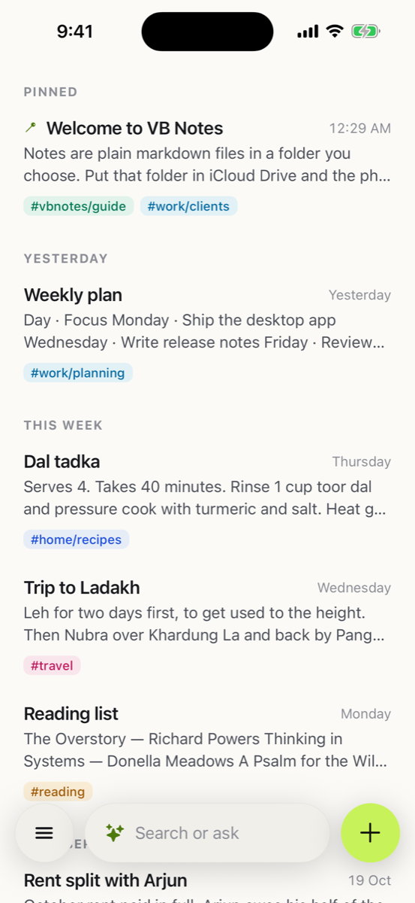 | 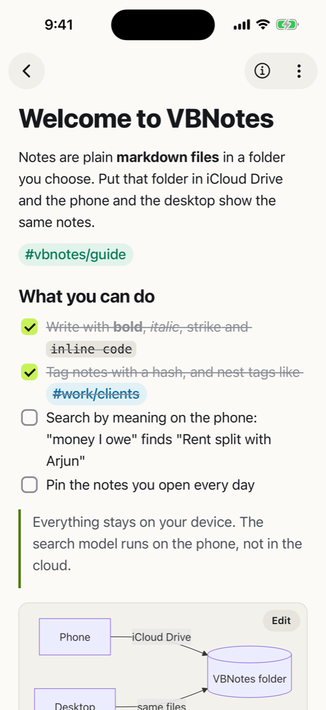 | 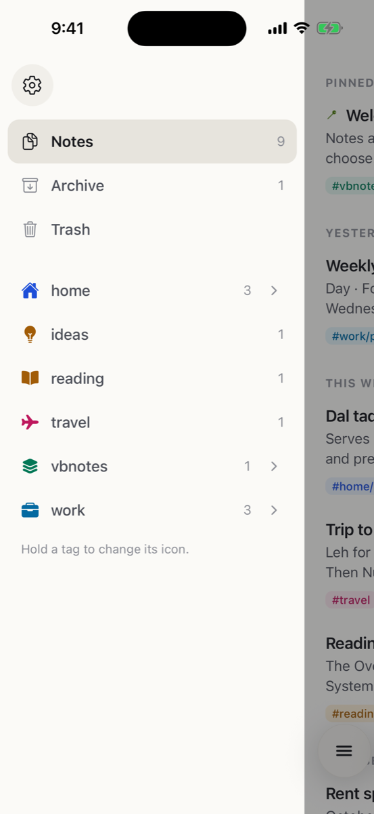 | 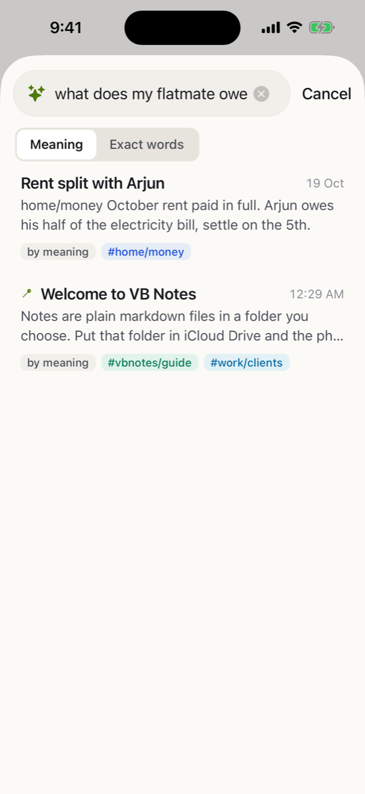 | 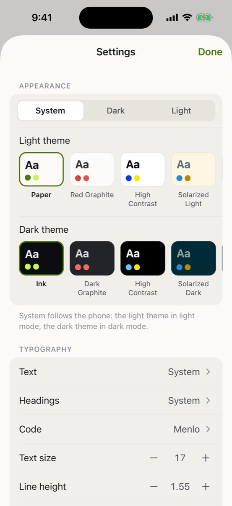 |

| Dark | Pictures | Tables and tasks | Code and diagrams | Tags |
|---|---|---|---|---|
| 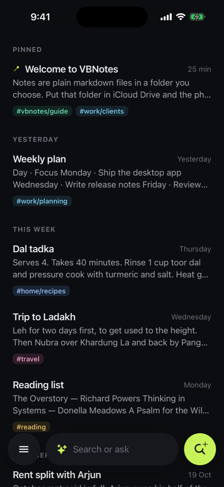 | 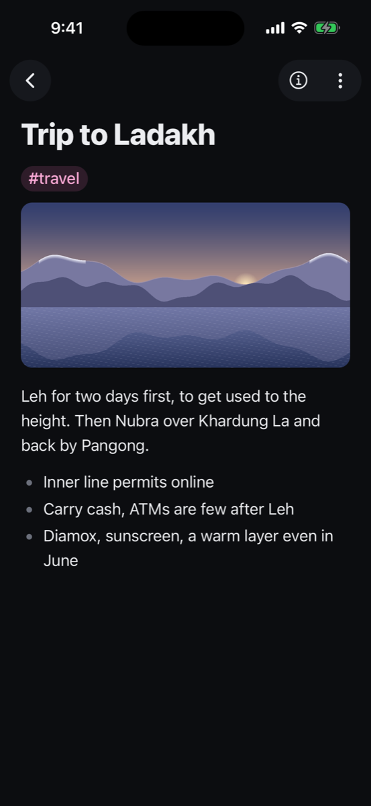 | 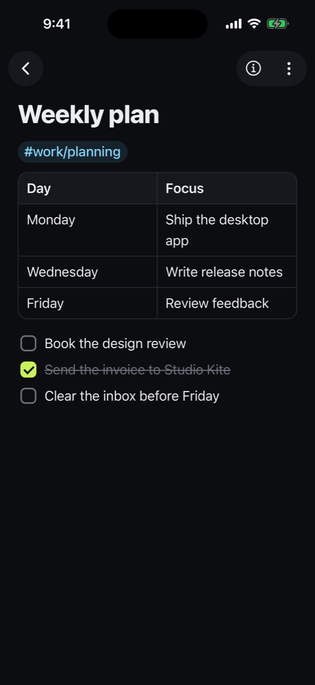 | 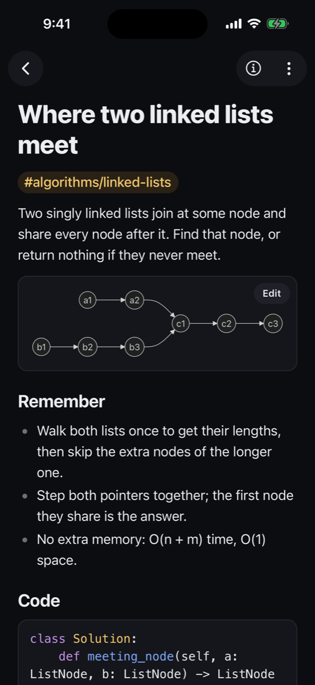 | 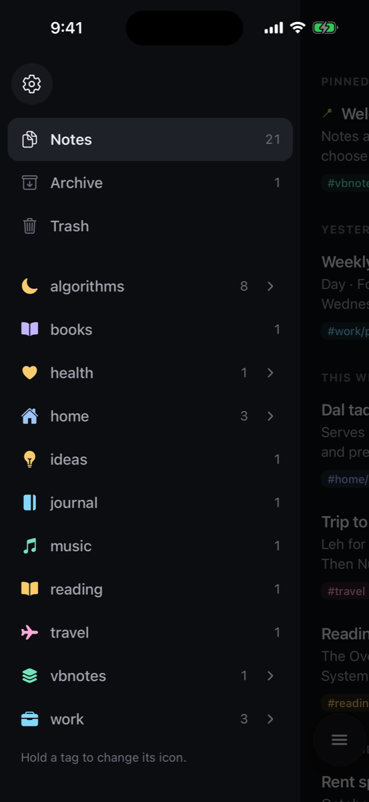 |

"what does my flatmate owe" finds *Rent split with Arjun* although the note never uses those words.

## Desktop (macOS, Windows, Linux)

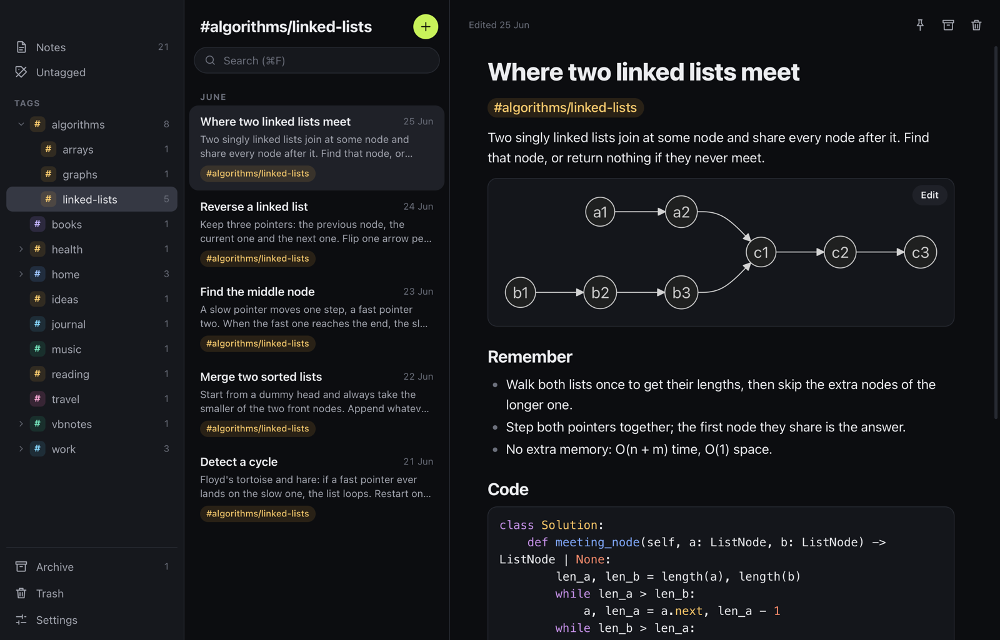

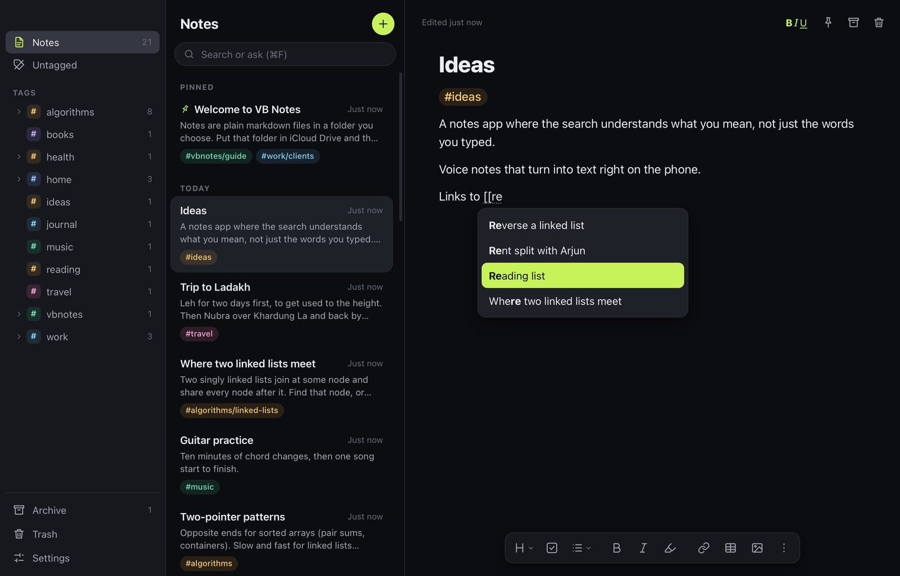

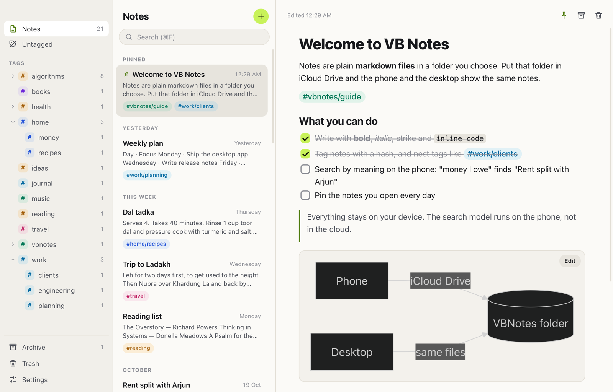

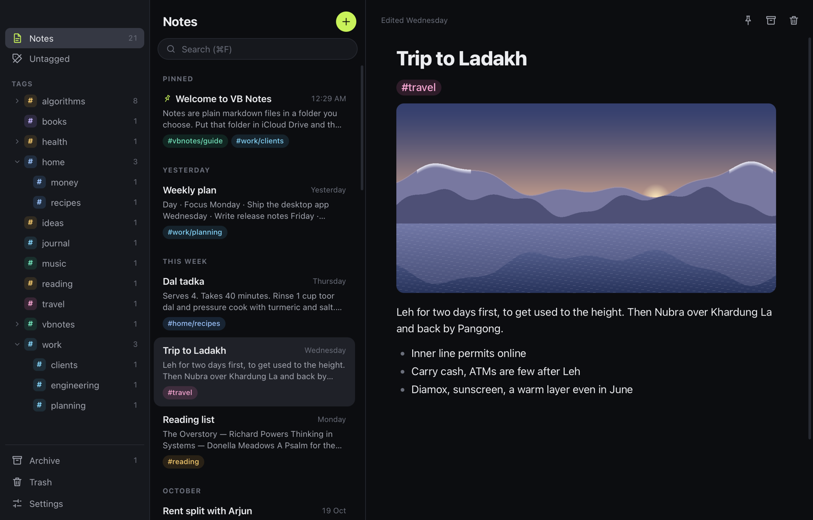

| Tags | Search | Right-click |
|---|---|---|
| 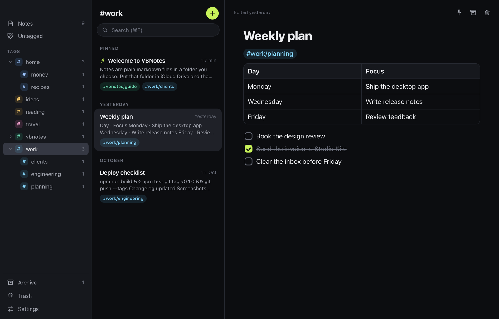 | 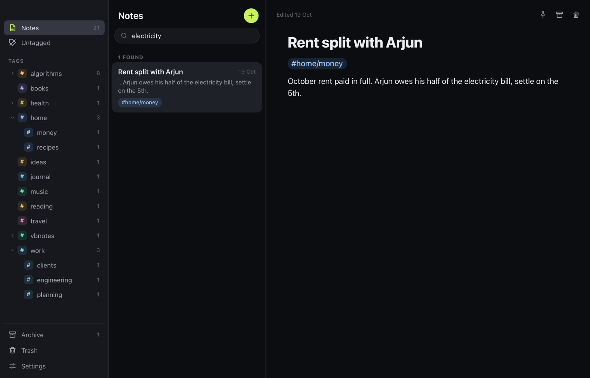 | 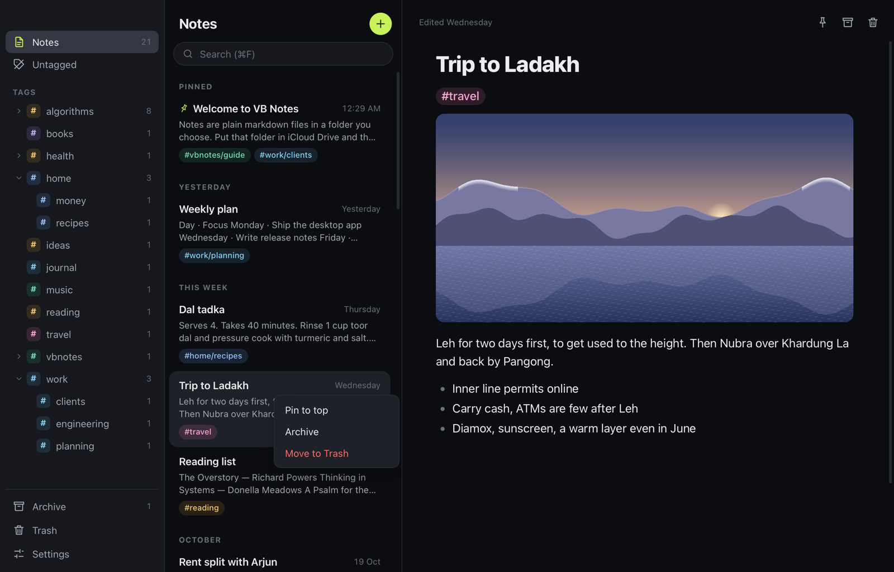 |

| Settings | Themes |
|---|---|
| 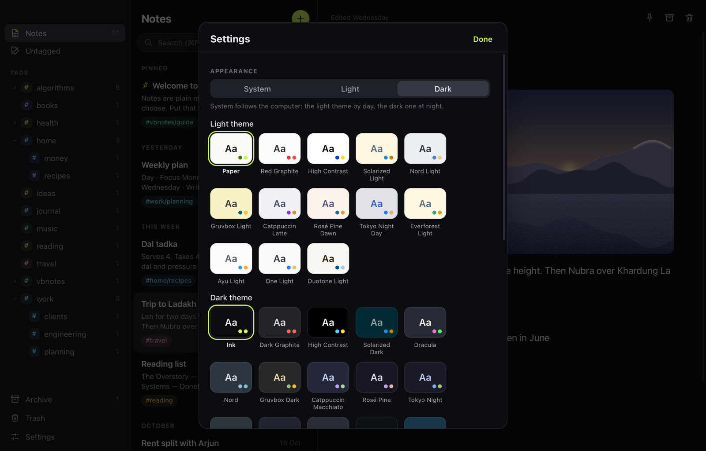 | 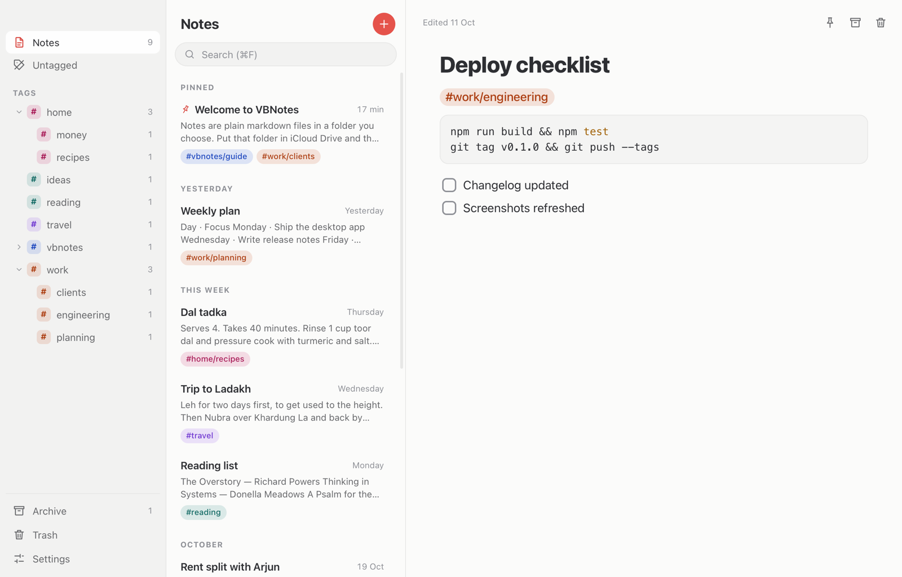 |

## What it does

- **Plain files.** Every note is one `.md` file. The file is named after the note's first line.
  Pictures and voice notes go in `attachments/` and are linked from the note.
- **Tags, not folders.** Write `#work` or a nested `#work/clients` anywhere in a note. The library shows
  them as a tree with counts. Settings › Hide from Notes keeps a tag's notes (at any level, so `melta`
  covers `#melta` and `#projects/melta`) out of the main list; they still show under their tag.
- **A rich editor that writes markdown.** Headings, lists, task lists, quotes, tables, code blocks
  coloured by language, Mermaid diagrams, pictures and audio. What you type is saved the way you typed it.
- **Links between notes.** Type `[[` and a few letters of a title: a list of matching notes comes up
  (↑ ↓ and Return, a click or a tap), and picking one writes `[[Note title]]` with the closing brackets.
  ⌘-click a link on the desktop or tap it on the phone to open that note; a link to a title that
  doesn't exist yet makes the note. The file keeps plain `[[Note title]]`, as Obsidian and Bear write it.
- **Style bar (desktop).** The BIU button over a note (or ⇧⌘Y) shows a bar under it, as in Bear:
  headings, todo, lists and quotes, bold, italic, highlight, link, table, pictures, and a menu with
  underline, strikethrough and code. Every item shows its shortcut, and the shortcuts are Bear's
  (⌘1–⌘6 for headings, ⌘L for a list, ⌘T for a todo, ⌘K for a link; Ctrl on Windows and Linux).
- **Search by meaning.** Each note is embedded on the device with LFM2.5-Embedding-350M and
  searched by meaning, mixed with keyword matches. The phone downloads it once (about 190 MB; two
  smaller models are offered, one of them multilingual); the desktop app runs the same model through
  llama.cpp (380 MB, on the GPU with Metal on Apple Silicon).
- **Drag files in (desktop).** Drop files on the notes list: `.md` and `.txt` files come in as notes,
  a picture or a sound file gets a note of its own, and a folder (an export from Bear, Obsidian or
  another app) comes in with its notes and pictures. Nothing in your folder is overwritten.
- **Open with › VB Notes (desktop).** Right-click a `.md` or `.txt` file in Finder or Explorer and open
  it with VB Notes: it comes into your notes and opens. VB Notes is only added to the Open with list;
  it doesn't become the default app for those files.
- **Chat with AI (desktop, off until you switch it on).** Ask about the open note or about all your
  notes, with your own key for OpenRouter, OpenAI, Anthropic, Google Gemini, Groq, Mistral, DeepSeek
  or xAI, or a model on your computer through Ollama. Only the notes that fit the question are sent,
  and only when you ask; the key stays on your computer, never in the notes folder.
- **Find or create (desktop, ⌘O / Ctrl+O).** A Spotlight-style finder: type a few words to jump to a
  note, or press Return on the first row to start a note with that title.
- **Fast with thousands of notes.** The list, tags and keyword search come from a SQLite index
  (FTS5) that is rebuilt from the files when needed, so opening the app reads only notes that changed.
- **Pins, Archive and Trash**, kept as folders and a small `.vbnotes/meta.json` beside your notes.
- **Themes.** Ink and Paper (with a lime "Volt" accent) plus Bear-style themes: Red Graphite,
  High Contrast, Solarized, Nord, Dracula, Gruvbox, Catppuccin, Rosé Pine, Tokyo Night and more.

## How it is built

| Part | Stack |
|---|---|
| Phone app | Expo SDK 58, React Native 0.88, expo-router, zustand, expo-sqlite |
| Editor | Tiptap 3 through `@10play/tentap-editor`, with our own extensions in `editor-web/` |
| Meaning search | `react-native-executorch` on the phone, llama.cpp (`llama-cpp-2`) on the desktop |
| Desktop app | Tauri 2 (Rust + the system webview, no Electron), React, the same editor extensions |
| Desktop index | SQLite with FTS5 in Rust (`desktop/src-tauri/src/index.rs`), the same schema as the phone |

```
src/app            phone screens: notes, note, search, settings
src/components     list rows, library, editor host, toolbars
src/store          notes store, SQLite index (noteDb.ts), shared note model (noteModel.ts)
src/search         embedding models, meaning index, merged search
editor-web         the editor page (Vite), shared by the phone and the desktop
desktop/src        desktop screens (React)
desktop/src-tauri  desktop back end: files, folder watching, index (Rust)
modules/vb-folder  iOS module that keeps a picked folder (iCloud Drive) open across launches
```

## Build it

Phone (needs Xcode; meaning search needs a development build):

```bash
npm install
npm run editor:build        # editor page → src/editor/editorHtml.js
npx expo run:ios
```

Desktop (needs Rust 1.90+, CMake and, on Linux, `libwebkit2gtk-4.1-dev` and `libclang-dev`):

```bash
npm install                 # the desktop page uses the repo's packages
cd desktop && npm install
npm run tauri dev           # or: npm run tauri build
```

Open a folder from the command line with `vbnotes ~/Notes` (macOS: `open -a "VB Notes" --args ~/Notes`).

## Releases

Pushing a tag like `v0.1.0` builds Windows, Linux and Android in GitHub Actions
(`.github/workflows/release.yml`) and adds them to the release. The macOS app is signed with a
Developer ID and notarized on a Mac, then uploaded to the same release.
